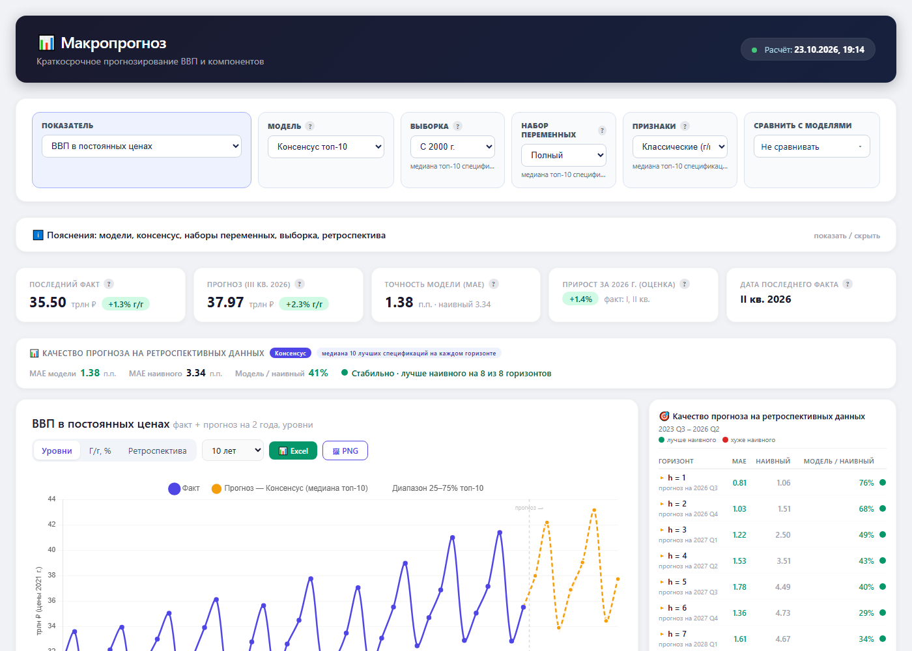

# Russian Forecasting: прогнозирование в реальном времени

Автоматическая система прогнозирования основных **макроэкономических показателей России** на 2 года вперёд:
данные скачиваются с data.iep.ru, модели проверяются на псевдо-реальном бэктесте последних 3 лет,
для каждого показателя автоматически выбирается лучшая модель и спецификация, результаты выводятся в дашборд.

### 📊 [Открыть интерактивный дашборд](https://fokinikita.github.io/russia_forecasting/dashboard/macro_dashboard.html)

[](https://fokinikita.github.io/russia_forecasting/dashboard/macro_dashboard.html)

> Ветка `main_auto_pipeline`. Исходный эксперимент на вручную собранных excel-таблицах
> (`main.py`, `models/`, `preds/`, `mfbvar.R`) остался в ветке `main`.

## Прогнозируемые показатели (в постоянных ценах, темп роста г/г)

1. ВВП
2. Потребление домашних хозяйств
3. Валовое накопление
4. Валовое накопление основного капитала

## Модели

| модель | тип | реализация |
|---|---|---|
| CatBoost (`gb`) | ML, прямой прогноз на каждый горизонт | `forecasting/models.py` |
| NGBoost (`ngb`) | ML, прямой прогноз | `forecasting/models.py` |
| TabNet (`tabnet`) | нейросеть, прямой прогноз | `forecasting/models.py` |
| DFM (`dfm`) | динамическая факторная модель, все цели и горизонты сразу | `forecasting/dfm.py` |
| MF-BVAR (`mfbvar`) | байесовский VAR смешанной частоты (R) | `forecasting/mfbvar.py`, `forecasting/r/` |
| наивный | последний известный темп роста | бенчмарк в метриках |

## Быстрый старт

```bash
python -m pipelines.run_realtime                    # всё: данные -> бэктест -> прогноз -> дашборд
python -m pipelines.run_realtime --no-refresh       # без скачивания данных
python -m pipelines.run_realtime --models gb mfbvar # только часть моделей
python -m pipelines.run_realtime --only future      # только прогноз в будущее
python -m pipelines.run_realtime --run-id 2026-10-22 --retry-failed   # досчитать упавшие спецификации
python -m pipelines.build_dashboard                 # пересобрать дашборд (--run-id, --as-of 2026-11-15)
python -m data_iep.pipeline                         # только скачать данные
python -m pytest tests -q                           # тесты
```

Полный запуск — около 5 часов на 8 ядрах (из них MF-BVAR ~20-40 мин). Повторный запуск с тем же
`--run-id` продолжает с чекпойнтов. Для MF-BVAR нужен R с пакетом mfbvar (см. ниже) — проще всего через Docker.

## Данные (data.iep.ru)

4 квартальных показателя + 61 месячная переменная, всегда из **последнего** релиза (vintage) каждого датасета.
Сохраняются в `data/iep/`; если сайт недоступен, пайплайн работает на сохранённой копии.

```text
data_iep/
├── client.py         # HTTP-клиент API: dataset uuid -> последний vintage -> линии -> наблюдения
├── series_config.py  # реестр рядов: переменная -> датасет + измерения + тип преобразования
├── collectors.py     # QuarterlyCollector / MonthlyCollector / DailyCollector -> 3 датафрейма
├── transform.py      # цепные индексы -> базисные, склейка ВВП по базовым годам, daily -> monthly
└── pipeline.py       # сбор + преобразование + сохранение
```

Как устроен API:
1. `GET /analytic/api/v1/search/datasets/family/{uuid}` -> `vintage_id` последнего релиза
2. `GET /analytic/api/v1/vintage/lines_list?vintage_id=...` -> все ряды датасета с готовыми `selector`
3. `POST /analytic/api/v1/vintage/line` c `selector` -> наблюдения (нужен заголовок `Accept-Language`)

## Как устроен бэктест (псевдо real-time)

Тест = последние 12 кварталов с известным ВВП, горизонты 1-8 кварталов (h=1 — наукаст текущего квартала).
Прогноз квартала t на горизонте h делается из точки T = t - h + 1 моделью, оцененной только на данных,
известных до T (расширяющееся окно, переоценка каждые `RT_REFIT_EVERY` кварталов). Признаки: месячные
данные квартала T (месяц `availability`) и последнее известное значение целевой переменной.

**Сетка** (все параметры в `config.py`, блок `RT_*`): модель x начало обучения 2000 / 2010 x набор
переменных short / medium / all x признаки classic (log d12) / rolling (скользящие средние 3/6/12 мес.)
x доступность 1-3 месяца квартала x 4 цели x 8 горизонтов.

| набор | переменные |
|---|---|
| short | brent, retail_real, miacr, ipi |
| medium | short + reer, ex_usd, im_usd, un, comm_freight |
| all | все 61 месячная переменная (для MF-BVAR — 20 самых информативных) |

```text
forecasting/
├── features.py    # месячные признаки: log d12 / d12 и их скользящие средние
├── dataset.py     # квартальная таблица: цели (log d4) + месячные признаки по месяцам квартала
├── design.py      # прямой многошаговый дизайн X(T) -> y(T+h-1)
├── models.py      # GB / NGB / TabNet: единый интерфейс, early stopping + refit
├── dfm.py         # DynamicFactorMQ: все цели и горизонты сразу, без заглядывания в будущее
├── mfbvar.py      # MF-BVAR: подготовка данных, вызов R, откат на прошлый прогноз при ошибке
├── r/mfbvar_forecast.R  # R-воркер: оценка mfbvar в каждой точке прогноза
├── experiment.py  # сетка спецификаций, план бэктеста, параллельный запуск с чекпойнтами
├── evaluation.py  # RMSE / MAE / bias относительно наивного, rolling-метрики, автовыбор спецификации
├── pipeline.py    # весь цикл + сохранение результатов
├── report.py      # чтение результатов запуска
└── dashboard.py   # сборка HTML-дашборда
```

## Результаты

```text
results/
├── runs/<дата>/run_info.json, run.log
├── runs/<дата>/backtest/   metrics.csv (RMSE/MAE/bias по спецификации x цели x горизонту), ranking.csv,
│                           best.csv, selected_specs.csv, rolling.csv, errors.parquet, forecasts_<model>.parquet
├── runs/<дата>/future/     forecasts.csv (все спецификации), selected.csv, best.csv, consensus.csv
├── metrics_history.csv     метрики каждого запуска — как меняется качество с приходом новых данных
└── forecasts_history.csv   прогнозы каждого запуска (auto, auto_<model>, consensus, best_spec)
```

### Автоматический выбор спецификации

`backtest/selected_specs.csv`: для каждой модели x цели x доступности автоматически выбираются начало
обучающей выборки, набор переменных (размер модели) и тип признаков — по RMSE относительно наивного
прогноза, усреднённой по всем 8 горизонтам (одна спецификация на всю 2-летнюю траекторию, это устойчивее,
чем выбор победителя на каждом горизонте). Спецификации с пропущенными горизонтами участвуют, только если
нет полных. Затем модели ранжируются тем же критерием (`model_rank`); `model_rank = 1` — итоговая
«Лучшая спецификация» (`future/selected.csv`, метод `auto` в `forecasts_history.csv`).

## Дашборд

`dashboard/macro_dashboard.html` — один файл, открывается двойным кликом, работает без интернета.
Пересобирается после каждого `run_realtime`. Макет — `dashboard/template.html`.

* «Лучшая спецификация» — автовыбор модели и спецификации; выбранные значения подставляются в поля
  «Выборка», «Набор переменных», «Признаки» и подсвечиваются.
* «Консенсус» — медиана 10 спецификаций с наименьшей ошибкой на ретроспективе.
* Вкладки «Уровни», «Г/г, %», «Ретроспектива»; в ретроспективе горизонт выбирается кнопками h = 1…8.
* Кнопка «Excel» выгружает данные открытой вкладки (в ретроспективе — факт и прогнозы на всех горизонтах).
* Доступность данных по умолчанию — из календаря: 1-й месяц квартала → 1, 2-й → 2, 3-й → 3.
* Ссылки на конкретный вид: `macro_dashboard.html#target=inv&model=gb&view=test&h=4`.

## MF-BVAR

R-пакет `mfbvar` 0.5.6 удалён из CRAN, ставится из `mfbvar_0.5.6.tar.gz` в репозитории
(архив: https://cran.r-project.org/src/contrib/Archive/mfbvar/). Python готовит данные и вызывает
`Rscript forecasting/r/mfbvar_forecast.R` для каждой спецификации — бэктест, метрики, выбор спецификации и
прогноз в будущее считаются тем же кодом, что и для остальных моделей.

* Одна спецификация даёт все 4 цели и все 8 горизонтов (VAR, прогноз рекурсивный).
* Информация в точке T: месячные ряды до месяца `availability` квартала T, цели до T-1 (рваный край
  обрабатывается моделью). Модель переоценивается в **каждой** точке (`RT_REFIT_EVERY` не используется).
* `rolling` для MF-BVAR — только 3-месячное скользящее среднее (`RT_MFBVAR_ROLLING_WINDOW`): три окна
  одного ряда в одном VAR почти коллинеарны.
* `all` ограничен 20 рядами (`RT_MFBVAR_MAX_VARIABLES`): на 61 ряде оценка либо падает с вырожденной
  матрицей, либо идёт часы. Ряды выбираются по средней |корреляции| с целями только на данных до первой
  точки прогноза (без заглядывания в будущее), почти дубли (|corr| > 0.95) пропускаются.
* **Ошибки.** Каждая точка оценивается до `RT_MFBVAR_MAX_ATTEMPTS` раз с разным seed. Если не вышло —
  берётся прогноз из предыдущей точки (до `RT_MFBVAR_MAX_FALLBACK` кварталов назад; такие строки видно по
  `refit_date < origin`). Если и его нет — точка пропускается. Падение или зависание R
  (`RT_MFBVAR_ORIGIN_TIMEOUT`) обрабатывается так же, остальные точки досчитываются.
* В прогнозе в будущее неудавшиеся спецификации (любой модели) берутся из последнего предыдущего запуска
  (`RT_FUTURE_FALLBACK_TO_PREVIOUS_RUN`, колонка `source_run` в `future/forecasts.csv`).
* Локально на Windows: `set RSCRIPT=C:\Program Files\R\R-4.1.0\bin\Rscript.exe` (или Rscript в PATH).

## Сервис: еженедельный запуск (Airflow + S3)

Каждый **понедельник в 05:00 МСК** Airflow запускает весь цикл, все промежуточные результаты
сохраняются в S3 в папки с датой запуска. Всё работает в **одном контейнере**: Airflow
(`airflow standalone`, SQLite только для состояний запусков) + модели Python и R.

```text
resolve_run_date ─┬─ cbr_forecasts ───────────────────────────────────────────────┐
                  └─ collect_data ─ backtest_gb ─ backtest_ngb ─ backtest_tabnet   │
                       ─ backtest_dfm ─ backtest_mfbvar ─ evaluate_backtest       │
                       ─ forecast_future ──────────────────────────────── build_dashboard
```

| шаг | что делает | куда пишет в S3 |
|---|---|---|
| `collect_data` | данные data.iep.ru (если сайт недоступен — последние из S3) | `raw_data/<дата>/quarterly.parquet`, `monthly`, `daily`, `raw_*`, `metadata` |
| `backtest_<модель>` | псевдо real-time бэктест одной модели | `retro_metrics/<дата>/forecasts_<модель>.parquet` |
| `evaluate_backtest` | метрики, рейтинг, автовыбор спецификаций | `retro_metrics/<дата>/metrics.parquet`, `selected_specs`, `best`, `ranking`, `rolling`, `errors`, `run_info.json` |
| `forecast_future` | прогноз на 8 кварталов, сохраняет обученные модели выбранных спецификаций | `forecasts/<дата>/…`, `models/<дата>/<модель>/…` |
| `cbr_forecasts` | проверяет https://www.cbr.ru/dkp/cal_mp/, скачивает и разбирает новые «Среднесрочные прогнозы» | `cbr_forecasts/pdf/`, `cbr_forecasts/all_forecasts.parquet`, `cbr_forecasts/<дата>/` |
| `build_dashboard` | HTML-дашборд + сравнение с 3 последними прогнозами ЦБ | `dashboard/<дата>/macro_dashboard.html`, `dashboard/latest/` |

Также: `history/metrics_history.parquet`, `history/forecasts_history.parquet` (все запуски),
`airflow_logs/` (логи задач). Таблицы хранятся в parquet. Каждый шаг сам забирает входные данные из S3,
поэтому упавшую задачу можно просто перезапустить (Clear в интерфейсе). Если упал бэктест одной модели,
остальные считаются, а оценка идёт по моделям, которые досчитались. Готовая ссылка на дашборд
(действует 7 дней) — в логе задачи `build_dashboard`.

**Прогноз ЦБ в дашборде.** В таблице «Темп роста за календарный год» добавлены столбцы с диапазонами
базового сценария трёх последних среднесрочных прогнозов Банка России (ВВП, потребление домашних хозяйств,
валовое накопление, валовое накопление основного капитала; прирост к предыдущему году).
✓ — наш прогноз внутри диапазона ЦБ, ▲/▼ — выше/ниже.

### Развернуть на сервере

```bash
git clone git@github.com:fokinikita/russia_forecasting.git && cd russia_forecasting
git checkout main_auto_pipeline
cp .env.example .env && nano .env      # ключи S3, пароль Airflow, лимиты ресурсов
docker compose up -d --build           # первая сборка ~15-20 минут (компиляция mfbvar)
```

Если Docker установлен через snap, проект должен лежать в `/root` или `/home` (snap не видит `/opt`);
на сервере проекта — `/root/projects/russia_forecasting`.

Интерфейс Airflow: `http://<сервер>:8095`, пользователь `admin`, пароль `AIRFLOW_ADMIN_PASSWORD` из `.env`.
Обновить код: `git pull && docker compose up -d --build`.

Ресурсы (`.env`): `MEM_LIMIT` и `CPUS` — жёсткие лимиты контейнера, `N_JOBS` / `MFBVAR_N_JOBS` /
`DFM_N_JOBS` — число параллельных процессов моделей. Задачи DAG выполняются по одной.

**Ручной запуск** — «Trigger DAG w/ config»: `run_date` (по умолчанию сегодня), `profile = quick`
(маленькая сетка, ~15-30 минут, для проверки сервиса), `prefix = _smoke` (писать в отдельную папку бакета),
`models`, `force` (пересчитать то, что уже есть в S3). Отдельный шаг без Airflow:

```bash
docker compose exec airflow python -m service.cli check                       # доступ к S3
docker compose exec airflow python -m service.cli backtest --model gb --date 2026-11-02
docker compose exec airflow python -m service.cli dashboard --date 2026-11-02
```

Код сервиса: `service/` (`storage.py` — S3, `layout.py` — структура папок, `stages.py` — шаги,
`cbr.py` — прогнозы ЦБ, `cli.py`), DAG — `orchestration/dags/russia_forecasting.py`.

## Docker (Linux-сервер)

**Один образ на Python и R** (а не два контейнера): R здесь только воркер, который Python вызывает через
`Rscript` на каждую спецификацию. Два контейнера потребовали бы очередь задач или HTTP-API между ними и
общий том для обмена данными — больше движущихся частей ради одной модели, при этом ни масштабирования,
ни независимых релизов это не даёт. Образ: `rocker/r-ver:4.2.2` (CRAN зафиксирован на снапшот),
RcppArmadillo 0.11.4.2.1 и stochvol 3.2.0 закреплены (с ними mfbvar точно собирается), mfbvar — из
tar.gz, Python 3.12 через uv, torch CPU-only, версии библиотек — как в рабочем окружении.

В этом же образе установлен Airflow (отдельный virtualenv `/opt/airflow-venv`, у Airflow свои версии
зависимостей), см. раздел «Сервис». Старый ручной запуск всего цикла без S3 тоже работает:

```bash
docker compose run --rm airflow python -m pipelines.run_realtime                 # данные -> бэктест -> прогноз -> дашборд
docker compose run --rm airflow python -m pipelines.run_realtime --models mfbvar --no-refresh
docker compose run --rm airflow python -m pytest tests -q
```

## Структура проекта

```text
russia_forecasting/
├── config.py               # все настройки (модели, сетка, MF-BVAR, пути)
├── data_iep/               # скачивание и преобразование данных data.iep.ru
├── forecasting/            # модели, бэктест, метрики, выбор спецификации, дашборд
├── pipelines/              # точки входа: run_realtime, build_dashboard
├── service/                # еженедельный сервис: шаги, S3, прогнозы ЦБ
├── orchestration/dags/     # DAG Airflow
├── dashboard/              # шаблон и готовый HTML-дашборд
├── data/iep/               # сохранённые данные
├── results/                # результаты запусков и история
├── tests/                  # тесты (pytest)
├── Dockerfile, docker-compose.yml, docker/, requirements-docker.txt
├── mfbvar_0.5.6.tar.gz     # архив R-пакета mfbvar
├── pyproject.toml, poetry.lock
└── README.md
```

Ноутбуки (`*.ipynb`) — для локального анализа, в репозиторий не попадают (`.gitignore`).
